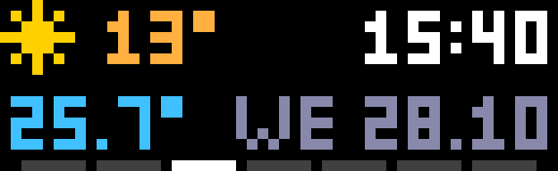
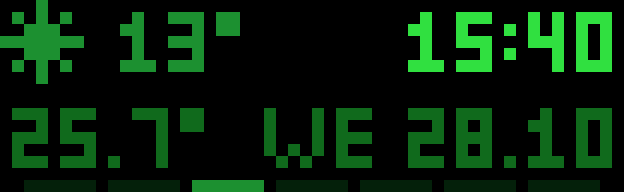
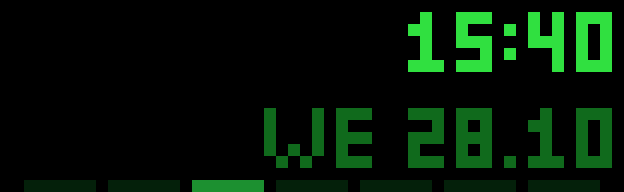
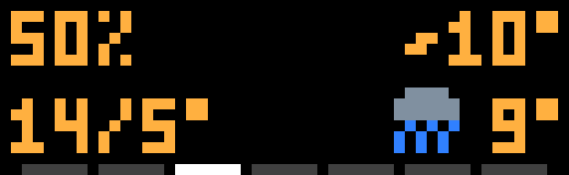
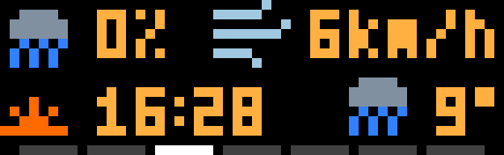
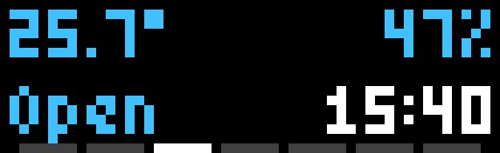
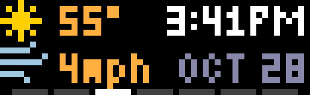
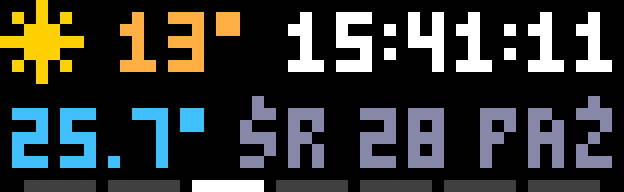
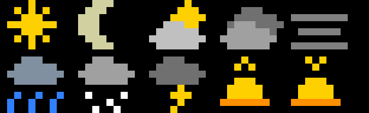

# Glance Clock for AWTRIX NG

A small, tidy clock for [AWTRIX NG](https://github.com/Blueforcer/awtrix-ng) panels of 52×16 pixels
and larger, such as the Ulanzi TC002. Instead of filling the panel with huge digits, it puts
everything you want to see at a glance on one screen: the time and date, the weather outside, and
readings from your own sensors.



**Get it on the AWTRIX Hub: [awtrix.de/script/fDmv7toQMZbE](https://awtrix.de/script/fDmv7toQMZbE)**

Each of the four corners shows what you pick, by day and by night. Weather comes from
[Open-Meteo](https://open-meteo.com): free, no account, no API key. The icons are drawn by the
script, so there is nothing to install.

## Examples

| | |
|:---:|:---:|
|  |  |
| Night mode with its own colours and brightness | A night layout that leaves two corners empty |
|  |  |
| No Home Assistant needed: humidity, feels-like, today's high/low, tomorrow | Rain chance, wind, the next sunset, tomorrow |
|  |  |
| MQTT readings: a room temperature, a humidity, a door contact | 12-hour clock, °F, mph, month names |
|  |  |
| Polish names, a custom date, seconds | The icons: clear day and night, partly cloudy, cloudy, fog, rain, snow, thunderstorm, sunrise, sunset |

<sub>Real frames from a Ulanzi TC002, enlarged.</sub>

## Features

- **Four corners**, each showing the time, the date, the current weather, an MQTT reading, the
  outdoor humidity, the feels-like temperature, today's high and low, tomorrow's weather, today's
  chance of rain, the wind, the next sunrise or sunset, or nothing
- **Day and night**: night mode on a schedule or always, with its own layout, colours and
  brightness
- **Time**: 24h or 12h with AM/PM, optional leading zero and seconds, a steady, blinking or pulsing
  colon
- **Date**: presets with dots, dashes, slashes or month names, or a pattern of your own; weekday and
  month names in English, Polish, German, French and Ukrainian
- **Week bar**: seven dashes on the bottom row with today lit
- **Weather**: temperature in °C or °F, wind in km/h, m/s or mph, and `off` when the forecast is
  out of date
- **Up to four MQTT readings**: a plain value or one field of a JSON message (Zigbee2MQTT,
  Tasmota, Shelly, Home Assistant), with replacements such as `true=Closed`, decimals, a unit, a
  short label, and `off` when the sensor goes quiet
- **Larger panels**: the corners are anchored to the panel's edges and spread out

## Installation

**From the AWTRIX Hub:** open [Glance Clock on the Hub](https://awtrix.de/script/fDmv7toQMZbE) and
send it to your clock.

**Manually:** in the AWTRIX NG web UI, open **Scripts**, create a new script named `Glance-Clock`, paste
[`glance-clock.ax`](glance-clock.ax) and save. Or upload it over HTTP:

```sh
curl -X PUT --data-binary @glance-clock.ax http://<clock-ip>/api/v1/apps/script/Glance-Clock
```

Then open the app's settings (**Apps** → gear icon) and set your **latitude** and **longitude**
under Weather. The default is Bielsko-Biała, Poland.

## Settings

The settings page has these groups, in this order.

| Setting | Default | |
|---|---|---|
| **Day:** Top left, Top right, Bottom left, Bottom right | Weather now, Time, MQTT reading 1, Date | what each corner shows; see below |
| **Day:** Weather icons | on | |
| **Day:** Brightness | 0 | 0 leaves the device brightness alone; otherwise set when night mode ends |
| **Day:** colours | | time, date, weather (temperature, humidity, wind, rain, sun times), MQTT readings, week bar today and other days |
| **Night:** Night mode | Off | Off, Scheduled (from From until Until) or Always |
| **Night:** From, Until | 22:00, 07:00 | the schedule; it may wrap past midnight |
| **Night:** Top left … Bottom right | Same as day | a corner can show something else at night, or nothing |
| **Night:** Weather icons | on | |
| **Night:** Brightness | 8 | 0 leaves the device brightness alone |
| **Night:** Colon | steady | steady, blink or pulse; at low brightness a dimmed colour changes hue, so pulsing looks off |
| **Night:** colours | green, with the date, weather, readings and today in dim red | the same list as Day; colours of one channel (pure red, green or blue) keep their hue at low brightness |
| **Time:** Hour format | 24h | 24h or 12h |
| **Time:** AM/PM | on | 12h only |
| **Time:** Leading zero | on | 08:05 rather than 8:05 |
| **Time:** Colon | steady | steady, blink or pulse, by day |
| **Time:** Seconds | off | adds `:ss`; the time gets wider |
| **Date:** Language | English | weekday and month names: English, Polski, Deutsch, Français, Українська |
| **Date:** Weekday in the date | on | for the presets; a custom format places the weekday itself with `ww` |
| **Date:** Date format | dd.mm | dd.mm, dd.mm.yy, dd-mm, dd-mm-yy, mm/dd, mm/dd/yy, yyyy-mm-dd, mon dd (`OCT 28`), dd mon or custom |
| **Date:** Custom date format | d.mm.yy | `dd` `d` `mm` `m` `mon` (month name) `yyyy` `yy` `ww` (weekday); text in single quotes and anything else is shown as typed, e.g. `ww d·m` or `'Day' d` |
| **Week bar:** Week bar | off | seven dashes on the bottom row, today lit |
| **Week bar:** Week starts on Monday | on | |
| **Weather:** Latitude, Longitude | Bielsko-Biała | the place whose weather is shown |
| **Weather:** Temperature unit | C | C or F |
| **Weather:** Wind unit | km/h | km/h, m/s or mph |
| **Weather:** Weather refresh | 10 min | how often the weather is fetched |
| **Weather:** Offline after | 120 min | without a fresh forecast for this long, weather elements show `off`; 0 never |
| **MQTT reading 1–4:** Topic | empty | a topic on the broker set in AWTRIX's MQTT settings |
| **MQTT reading 1–4:** JSON field | empty | empty for a plain value; `temperature` for `{"temperature":21.5}`; `room.temp` for nested values |
| **MQTT reading 1–4:** Replace values | empty | comma separated, case-insensitive: `true=Closed,false=Open`, `ON=On,OFF=Off` |
| **MQTT reading 1–4:** Decimals | 0 | as sent, 0, 1 or 2 |
| **MQTT reading 1–4:** Unit | ° | added after numbers, e.g. `°` or `%` |
| **MQTT reading 1–4:** Label | empty | short text before the value, e.g. `In` |
| **MQTT reading 1–4:** Offline after | 0 | minutes without a message before it shows `off`; 0 never |

### What a corner can show

| Option | Shows | Needs |
|---|---|---|
| Date | the date, as set under Date | |
| Empty | nothing | |
| Feels like | feels-like temperature, e.g. `~10°` | internet |
| High/low today | today's high and low, e.g. `14/5°` | internet |
| Humidity outdoors | outdoor relative humidity, e.g. `42%` | internet |
| MQTT reading 1–4 | that reading | an MQTT broker |
| Rain chance today | today's highest chance of rain, with a rain icon | internet |
| Sunrise/sunset | the next sunrise (yellow half sun) or sunset (orange) | internet |
| Time | the time | |
| Weather now | icon and outdoor temperature | internet |
| Weather tomorrow | tomorrow's weather icon and high temperature | internet |
| Wind | current wind speed, e.g. `6km/h` | internet |

Left corners start at the left edge and right corners end at the right edge. If a left corner is
too wide, the right corner on the same row wins and the left one is cut off.

## MQTT readings

### Straight from a device

Most devices publish JSON. A Zigbee2MQTT door sensor on `zigbee2mqtt/door` sends something like
`{"contact":true,"battery":100}`, where `contact: true` means closed:

| Setting | Value |
|---|---|
| Topic | `zigbee2mqtt/door` |
| JSON field | `contact` |
| Replace values | `true=Closed,false=Open` |
| Offline after | `120` |

A message without the field, such as a battery-only update, leaves the shown value alone. Several
readings may use the same topic, e.g. the `temperature` and `humidity` fields of one sensor.

### From Home Assistant

Publish the sensor to a topic, retained, and put that topic into the reading's **Topic** setting.
Publishing on a schedule keeps the panel calm when the sensor reports often:

```yaml
alias: "Room temperature to AWTRIX"
triggers:
  - trigger: time_pattern
    minutes: "/1"
actions:
  - action: mqtt.publish
    data:
      topic: awtrix/room/temp
      payload: "{{ states('sensor.room_temperature') }}"
      retain: true
```

The last value of each reading is kept across restarts, so saving the settings does not empty the
corner.

## Good to know

- **Brightness is a device-wide setting.** Night mode remembers the brightness (and automatic
  brightness, on clocks with a light sensor) and gives it back in the morning. If another app also
  has a night mode, such as Night Clock, switch one of them off, or both will set the brightness.
  Removing the app during the night leaves the night brightness in place.
- **Sunrise and sunset** are given in the time zone of the coordinates you set, so set the place
  where the clock is.
- **Memory:** everything is in one script of about 34 KB of source. On clocks without PSRAM, remove
  scripts you do not use if the clock reports that it is out of memory.

## Requirements

- AWTRIX NG with scripting, on a panel of at least 52×16 pixels
- Internet access for the weather, an MQTT broker for the readings

## What next

Ideas for later versions are in [IDEAS.md](IDEAS.md).

## License

[MIT](LICENSE)
