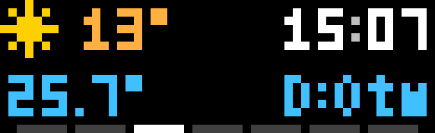

# Glance Clock for AWTRIX NG

A small, tidy clock for [AWTRIX NG](https://github.com/Blueforcer/awtrix-ng) panels of 52×16 pixels
and larger, such as the Ulanzi TC002. Instead of filling the panel with huge digits, it puts
everything you want to see at a glance on one screen:


| Top left | Top right |
|---|---|
| weather icon and outdoor temperature | time |
| **Bottom left** | **Bottom right** |
| a reading from MQTT, e.g. the room temperature | weekday and date |

That is the default layout: each corner can show any element, so you can swap them around or
leave one empty. An optional week bar on the bottom row lights today.

Weather comes from [Open-Meteo](https://open-meteo.com): free, no account, no API key. The icons
are drawn by the script, so there is nothing to install.


## Features

- Four corners, each showing whatever you pick: weather, time, date, an MQTT reading, the
  outdoor humidity, the feels-like temperature, today's high/low, tomorrow's weather and high, the chance
  of rain, the wind, the next sunrise or sunset, or nothing

   
- Small time with a steady, blinking or pulsing colon, 24h or 12h with AM/PM; and the date; weekday names in English, Polish, German,
  French or Ukrainian; date presets with dots, dashes or slashes, or a pattern of your own
- Optional week bar: seven dashes on the bottom row with today lit
- Outdoor temperature in °C or °F with a weather icon: clear (sun or moon), partly cloudy, cloudy, fog, rain,
  snow and thunderstorm
- Up to four readings from your MQTT broker: a plain value or one field of a JSON message (as sent by
  Zigbee2MQTT, Tasmota or Shelly), with replacements such as `true=Closed`, decimals, a unit, a
  short label, and `off` when the sensor goes quiet

  
- Night mode, on a schedule or always on: its own colours for every element (the weather icon
  included) and its own brightness

  
- Colours for every element
- The layout is anchored to the panel's edges, so it spreads out on larger panels

## Installation

In the AWTRIX NG web UI, open **Scripts**, create a new script, paste
[`glance-clock.be`](glance-clock.be) and save. Or upload it over HTTP:

```sh
curl -X PUT --data-binary @glance-clock.be http://<clock-ip>/api/v1/apps/script/Glance-Clock
```

Then open the app's settings (**Apps** → gear icon) and set your **latitude** and **longitude**.
The default is Berlin.

## Settings

| Setting | Default | |
|---|---|---|
| Top left, Top right, Bottom left, Bottom right | Weather now, Time, MQTT reading, Date | what each corner shows; see below |
| Hour format | 24h | 24h or 12h |
| AM/PM | on | 12h only |
| Leading zero | on | 08:05 rather than 8:05 |
| Colon | steady | steady, blink or pulse |
| Language | English | weekday and month names: English, Polski, Deutsch, Français, Українська |
| Weekday in the date | on | |
| Date format | dd.mm | dd.mm, dd.mm.yy, dd-mm, dd-mm-yy, mm/dd, mm/dd/yy, yyyy-mm-dd, mon dd (`OCT 28`), dd mon or custom |
| Custom date format | d.mm.yy | used when Date format is custom: `dd` `d` `mm` `m` `mon` (month name) `yyyy` `yy` `ww` (weekday); anything else is shown as typed, e.g. `ww d·m` |
| Week bar | off | seven dashes on the bottom row, today lit |
| Week starts on Monday | on | |
| Latitude, Longitude | Berlin | the place whose weather is shown |
| Temperature unit | C | C or F |
| Wind unit | km/h | km/h, m/s or mph |
| Weather refresh | 10 min | how often the weather is fetched |
| **MQTT reading 1–4:** Topic | empty | a topic on the broker set in AWTRIX's MQTT settings |
| **MQTT reading 1–4:** JSON field | empty | empty for a plain value; `temperature` for `{"temperature":21.5}`; `a.b` for nested values |
| **MQTT reading 1–4:** Replace values | empty | comma separated, case-insensitive: `true=Closed,false=Open`, `ON=On,OFF=Off` |
| **MQTT reading 1–4:** Decimals | 0 | as sent, 0, 1 or 2 |
| **MQTT reading 1–4:** Unit | ° | added after numbers, e.g. `°` or `%` |
| **MQTT reading 1–4:** Label | empty | short text before the value, e.g. `In` |
| **MQTT reading 1–4:** Offline after | 0 | minutes without a message before it shows `off`; 0 never |
| **Day:** Brightness | 0 | 0 leaves the device brightness alone; otherwise set when night mode ends |
| **Day:** colours | | time, date, weather (temperature, humidity, wind, rain, sun times), MQTT reading, week bar today and other days |
| **Night:** Night mode | Off | Off, Scheduled (between From and Until) or Always |
| **Night:** From, Until | 22:00, 07:00 | the schedule; it may wrap past midnight |
| **Night:** Weather icons | on | |
| **Night:** Brightness | 8 | 0 leaves the device brightness alone |
| **Night:** colours | greens | the same list as Day |

Brightness is a device-wide setting. With a day brightness of 0, the brightness the device had
before night began is restored in the morning. Long custom date formats can run into the reading
on the left; keep them short.

### What a corner can show

| Option | Shows | Needs |
|---|---|---|
| Weather now | icon and outdoor temperature | internet |
| Time | the time | |
| Date | the date, as set under Date | |
| MQTT reading 1–4 | that reading | an MQTT broker |
| Humidity outdoors | outdoor relative humidity, e.g. `42%` | internet |
| Feels like | feels-like temperature, e.g. `~10°` | internet |
| High/low today | today's high and low, e.g. `14/5°` | internet |
| Weather tomorrow | tomorrow's weather icon and high temperature | internet |
| Rain chance today | today's highest chance of rain, with a rain icon | internet |
| Wind | current wind speed, e.g. `6km/h` | internet |
| Sunrise/sunset | the next sunrise or sunset, arrow up or down | internet |
| Empty | nothing | |


Left corners start at the left edge, right corners end at the right edge. Keep the wider elements
(time, date) apart from each other on one row, or they overlap.

### Readings straight from a device

Most devices publish JSON. A Zigbee2MQTT door sensor on `zigbee2mqtt/door` sends something like
`{"contact":true,"battery":100}`, where `contact: true` means closed:

| Setting | Value |
|---|---|
| Topic | `zigbee2mqtt/door` |
| JSON field | `contact` |
| Replace values | `true=Closed,false=Open` |
| Offline after | `120` |

A message without the field, such as a battery-only update, leaves the shown value alone.

### A reading from Home Assistant

Publish the sensor to a topic, retained, and put that topic into the **MQTT topic** setting.
Publishing on a schedule keeps the panel calm when the sensor reports often, and fills the value
in within a minute after the script restarts:

```yaml
alias: "Room temperature to AWTRIX"
triggers:
  - trigger: time_pattern
    minutes: "/1"
actions:
  - action: mqtt.publish
    data:
      topic: awtrix/room/temp
      payload: "{{ states('sensor.room_temperature') }}"
      retain: true
```

## Requirements

- AWTRIX NG with scripting, on a panel of at least 52×16 pixels
- Internet access for the weather; an MQTT broker only for the bottom-left reading

## License

[MIT](LICENSE)
